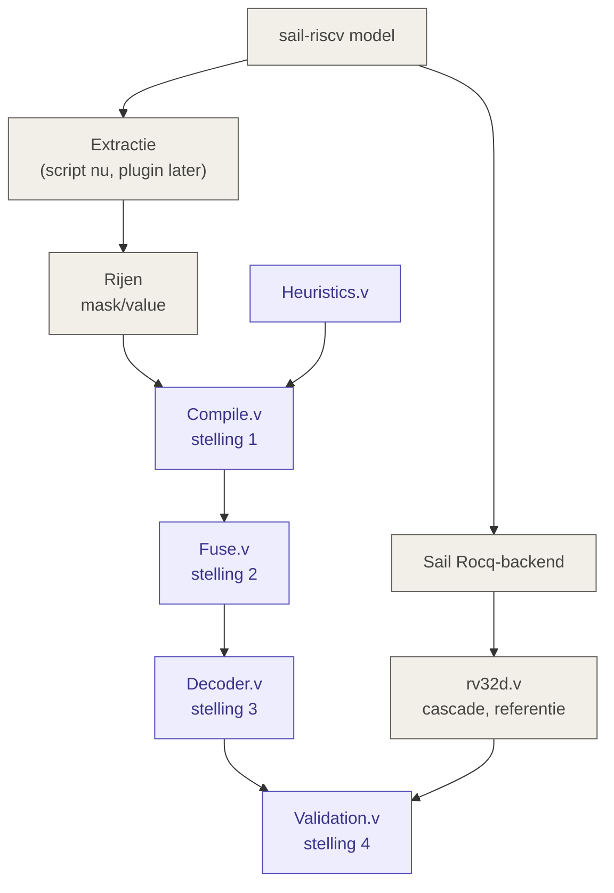

# Architectuur van het project

Doel: Sails decoder (een cascade die elke clause één voor één probeert) vervangen door een
beslisboom die automatisch uit de Sail-specificatie wordt opgebouwd en in Rocq correct bewezen is.

## 1. Pijplijn

Grijs = Sail en gegenereerde code (vertrouwd), paars = jouw Rocq-bibliotheek (bewezen).

## 3. Modules

| Module | Bevat | Status |
|---|---|---|
| Katamaran `Bitvector.v` | `bv n` en bewerkingen | bestaat |
| `EncdecRows.v` | de rijen, gegenereerd uit Sail | gegenereerd (met `N`, nog om te zetten naar `bv 32`) |
| `Rows.v` | `row` (mask, value), `matches`, `first_match` | te doen |
| `Tree.v` | `tree` (Leaf, Fail, Test i t0 t1), `eval` | te doen |
| `Heuristics.v` | Theiling-stap, Maranget p, q, n, d, b | te doen |
| `Compile.v` | `specialize`, `CC`, Lemma 1, stelling 1 | te doen |
| `Fuse.v` | bomen met multi-bit switch, `fuse`, stelling 2 | te doen |
| `Decoder.v` | `decode`, `encode`, stelling 3 | te doen |
| `Validation.v` | stelling 4 tegen `rv32d.v` | te doen |

