# Klad-versie van notes bij Honours program.


# Reading 

## Compiling Pattern Matching to good Decision Trees - Maranget (2001)
Naar aanleiding van meeting 13/10 , besloten mezelf wat te verdiepen in het opzetten van beslissingsbomen. De notes zijn een combinatie van een samenvatting alsook extra uitleg en mijn visie erop.
### Simplified source language
Eerst moeilijkheid kwam bij de formele definieite van type definities:
Ze werkt onder de assumptie dat constructors ergens anders gedefinieerd zijn (wat in de formele specificatie van [RISC-V-Sail][sail-riscv] ook het geval lijkt te zijn). We bekijken de waardes:
```math
 v::= c(v_1,\dots,v_a) \quad a \geq 0
```

> An implicit typing discipline for values is assumed. In particular, arities are obeyed, and, given a constructor c, one knows which signature it belongs to. In examples, we systematically omit () after constants constructors. i.e. we write Nil, true, 0, etc. - [Maranget][maranget]

Interpreteer ik als : we gaan er van uit dat de de constructors correct gebruikt worden, wat ik ook niet als een probleem zie
 
Verder werkt ze met *occurences* wat ze definieerd als 
> Sequenties van integers die een **positie** van sub-termen beschrijven

Formeler is een occurence oftewel leeg:  ``\Lambda`` of een integer ``k`` gevolgd door een occurence ``o`` genoteerd als: ``o\cdot k``.
Visueel zijn het *paden* naar subtermen:
```math
v/\Lambda = v \quad en \quad 
c(v_1,\dots,v_a)/o\cdot k = v_k / o
```
Dit concept is nieuw, maar in praktijk lijkt het niet heel moeilijk, we volgen gewoon de k-de term in de occurence en nemen de overgebleven subtree waarde.
Enkele notaties:
- prefix: ``o_1 `` prefix `` o_2`` als ``v/o_2`` een subterm is van ``v/o_1``
- incomptabilheid: beide geen prefix van een elkaar
We zullen werken met de *leftmost-outermost* ordering over occurences, wat ik interpreteer als stel we hebben occurunce ``o := 132\dots `` dat we eerst het meest linkse kind nemen van de root, vervolgens het 3de,...
We zien *patronen* als:
```math
\begin{aligned}
p ::=\;& \_                     && \text{wildcard} \\
  \mid\;& c(p_1, \dots, p_a)    && \text{constructor pattern } (a \ge 0) \\
  \mid\;& (p_1 \mid p_2)        && \text{or-pattern}
\end{aligned}
```
Ik zie dit als een beschrijving van de vorm van een waarde, "hoe een waarde er uit zou moeten zien". Het zijn dus ook alle waarden die passen in het patroon.
We definieren ook pattern vectors ``\vec p`` die sequenties van patronen `` (p_1,\dots,p_n)`` definieren. Alsook patroon matrices ``P``. En clause matrices ``P \rightarrow A``:
>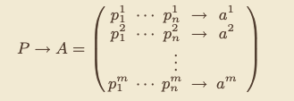


#### Semantiek van ML matching
We zeggen dat value v een instance is van patroon p : ``p \preceq v`` als een substituie ``\sigma`` bestaat zodat ``\sigma(p)= v``.
Bij *lineaire patronen* (zoals eerder gezien, komt dit overeen met:

```math
\begin{aligned}
\_ &\preceq v \\
(p_1 \mid p_2) &\preceq v
&&\text{iff } p_1 \preceq v \text{ or } p_2 \preceq v \\
c(p_1, \dots, p_a) &\preceq c(v_1, \dots, v_a)
&&\text{iff } (p_1 \cdots p_a) \preceq (v_1 \cdots v_a) \\
(p_1 \cdots p_a) &\preceq (v_1 \cdots v_a)
&&\text{iff, for all } i,\ p_i \preceq v_i
\end{aligned}
```
We noteren 'value v is geen instance van pattern p' als ``p \# v``.

Vervolgens definieren we *ML-matching*:
>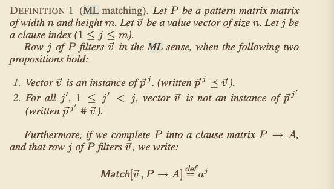
Intuitief komt dit overeen met: we controleren voor v of de rij die een patroon representeerd voldoet, en stoppen zodra dit geldt. Dit is ML matching.

#### Matrix decompositie
Het *compileren* process transformeerd clause matrices adhv 2 operaties.
1) Specialisatie door constructor : ``\mathcal{S}(c, P \rightarrow A)`` 
2) Compute default matrix : ``\mathcal{D}(P \rightarrow A)`` 
Beide transformaties applyen op de rijen van ``P \rightarrow A``
Voorbeeld:
> 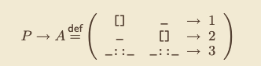
> 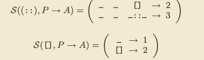
> 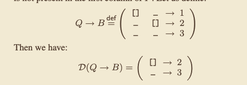

We zien dat we dus zullen "selecteren" op de constructor bij S en bij D we enkel de "wildcards" zullen behouden
Semantiek voor evalueren van een beslissingsboom:
> 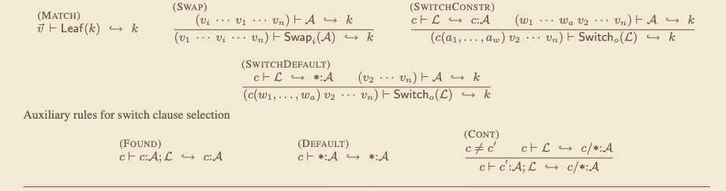


### Target talen

We definieren een beslissingboom als:
```math
\begin{aligned}
\mathcal{A} ::= \\
    Leaf(k) \\
    Fail \\
    Switch_o(\mathcal{L})\\
    Swap_i(\mathcal{A})
\end{aligned}
```
Hierbij is 
- ``k \in \mathbb N`` - een actie, welke clausule past
- Fail een failure, 
- switch een *multi-way test* - o een occurence : kijk naar waarde op occ o, en spring naar de tak die bij de constructor daar hoort
``\mathcal L ::= c_1:\mathcal A_1; \dots c_z:\mathcal A_z ; [*:\mathcal A]?``
waarbij ``c_1:\mathcal A_1`` een tak is begint de geteste waarde met ``c_1`` ga verder met A_1, met een mogelijke default tak
 We eisen verder dat :
 + we met dezelfde signatuur van constructors werken (geen Nil en true of 1 in een switch)
 + paarsgewijs verschillen
 + default is enkel aanwezig als hij exact nodig is 
- swap een *stack swap* - verplaatst instructie, swap het bovenste element van de stapel met het i-de element, en ga verder met boom A, nuttig voor de volgorde waarin we zullen parsen, hiermee kunnen we een optimale volgorde die we vinden effectief ook gebruiken, op te merken dat deze operatie dient voor het evalueren van de boom, niet per se deel van de structuur (zoals de rest dat wel is)
We zien dan ook nog de formele semantiek van een decision tree (zal later nuttig zijn bij bewijzen):
> 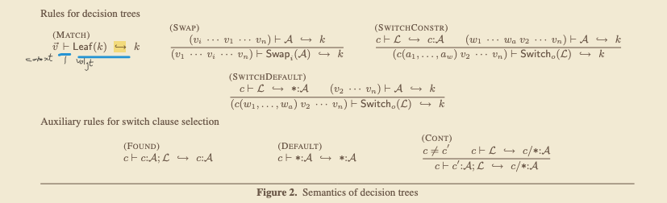

### Compilatie Schemas

We maken onderscheidt tussen constructor patronen en wildcards. Om met take-or patronen rekening te houden definieren we *generalied constructor patterns*
```math
\begin{aligned}
q::=\\
c(p_1,\dots,p_a)
(q|p)
\end{aligned}
```
Waarbij alle p's eender patroon zijn (bouwt dus verder op de eerder geziene patronen). We kunnen nu ook alle eerder geziene patronen omhoog trekken naar generalied constructor patronen via een "preprocessing phase".
Een *Compilatie schema* ``\mathcal{CC}`` is beschreven als een non-det functie die ``\vec o`` vector van occ neemt als de **fringe** alsook een clause matrix. We definieren compilatie als volgt:
1) als P geen rijen heeft, matching faalt altijd: of nog:
```math 
\mathcal{CC}(\vec \emptyset, \emptyset \rightarrow A) := Fail 
``` 
2) Als de eerste rij van P bestaat en volledig wildcards zijn, mathcing succeeds altijd, yields eerste actie:
> 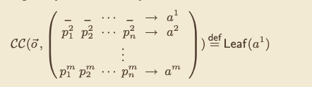
In het bijzonder is dit het geval als en rijen zijn maar geen kolommen
3) In alle andere gevallen: rijen m > 0 en kolommen n > 0 en er bestaat een column van welke er een patroon is dat geen wildcard is. Selecteer deze kolom i:
> 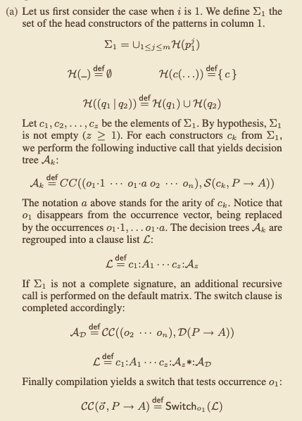


`` \mathcal H(p_1^j)`` hier is alle constructors die vanboven op een patroon staan
``$$\mathcal{A}_k = \mathcal{CC}\big((o_1{\cdot}1 \cdots o_1{\cdot}a\ \ o_2 \cdots o_n),\ \mathcal{S}(c_k, P \to A)\big)$$``
Doet heel veel, per constructor in die ``\Sigma`` creeren we een tak, door het kind in kwestie te nemen, alsook de correcte matrix decomp toe te passen (specialisatie)
We voegen als nodig een default branch toe adhv de default matrix.

### Correctheid

In dit deel bewijst de auteur enkele eigenschappen over compileren.
Lemma 1 deel 1 zegt ons dat we de branch 3(a) mogen nemen, deel 2 zegt dat de default branch ook oke is. Maranget bewijst het niet echt, voor de volledigheid en om mijn begrip van de definities te controleren werk ik het uit op papier:
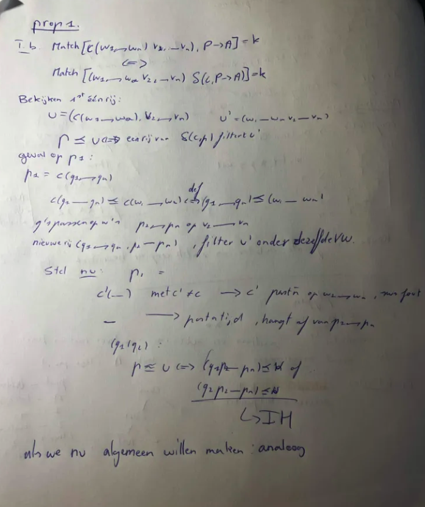

Hierna zien we wat vrij triviale voorbeelden voor pattern matching expressies, die elke compiler zou moeten kunnen bepalen. Hierna introduceren we de volgende term:

### Necessity
> Laat P een patroon matrix zijn. ``\vec o`` de een conventional occurence vector dus ``o_i = i`` en A een conventionele actie vector zijn ``a^j = j``,. Column i is nodig voor rij j als alle paden naar Leaf(j) in alle beslissingsbomen ``\mathcal{CC}(\vec o , P \rightarrow A)`` occurence i testen. Als kolom i nodig is voor alle rijen j, dan s kolom i **nodig**.

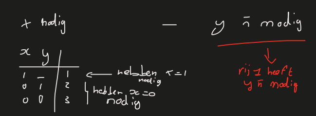

Heuristieken die zich op necessity baseren zullen dues nodige kolommen verkiezen boven niet nodige. Zo verwachten we kortere paden.

Een eerste stelling is al dat een kolom nodig is voor een rij als er een constructor in staat, dit is echter geen nodige eigenschap.
#### Berekenen van necessity:
We definieren ``\text{↯}``, een kunstmatige waarde, geen echte waarde, heeft geen construcotr, plaatst 1 ``\text{↯}`` in de vector op pos ``\omega``. Het idee is, als een switch ``\text{↯}`` moet bekijken, past geen enkele regel -> evaluatie loopt vast.

Evaluatietechnieken
1.
> Lemma : laat ``P \rightarrow A`` een clause matrix zijn met 1 kolom, ``\vec o `` pairwise incompatibele occ, laat ``\mathcal A = \mathcal{CC} (\vec o, P \rightarrow A)`` een bes boom zijn. Er geldt, ``\exists \vec v \text{ met } v_\omega = \text{ ↯ }`` en een actie k zo dat ``\vec v \vdash A ↪ k, \iff \mathcal A`` bevat een pad naar Leaf(k) dat geen ``o_\omega`` bevat.

Hieruit volgt duidelijk dat die kolom niet *nodig* is.


2.
We stellen ook :
```math
\_ \preceq \text{↯} \quad (p_1 | p_2) \preceq \text{↯} \iff p_1 \preceq \text{↯}
```
MAW enkel als het een wildcard is.
Waarom geeft dit ons extra info :
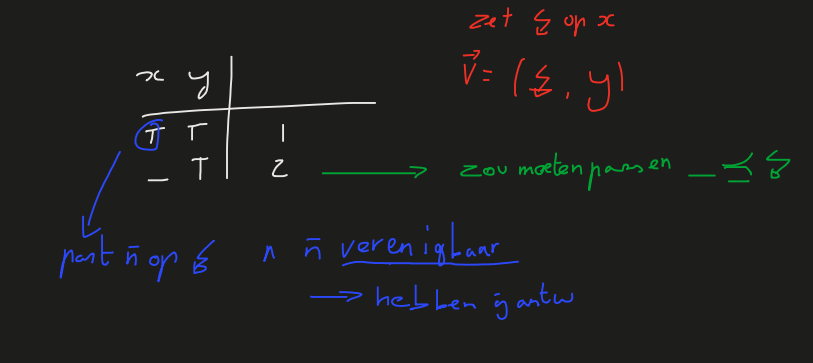
dus is x nodig voor rij 2, ondanks dat het een wildcard is

> Lemma :
> 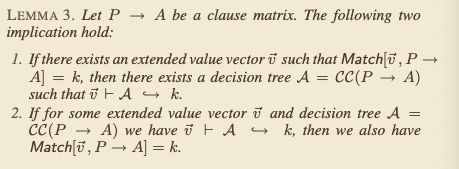

Dit betekent min of meer dat als een er een match bestaat die k geeft, er een boom bestaat die k geeft, en vice versa

Dan bekomen we 
> Lemma: Let ``P`` be a pattern matrix with rows and columns (``m > 0, n > 0``).
Let ``\vec v`` be an extended vector (``v_\omega = ↯``). Then row ``j`` of ``P`` filters ``\vec v`` if and only if:

1. Pattern ``p^j_\omega`` is not a generalized constructor pattern.
2. Row ``j`` of matrix ``P/\omega`` filters ``(v_1 \cdots v_{\omega-1}\ v_{\omega+1} \cdots v_n)``, where ``P/\omega`` is ``P`` with column ``\omega`` deleted:

```math
P/\omega =
\begin{pmatrix}
p^1_1 \cdots p^1_{\omega-1} & p^1_{\omega+1} \cdots p^1_n \\
p^2_1 \cdots p^2_{\omega-1} & p^2_{\omega+1} \cdots p^2_n \\
\vdots & \vdots \\
p^m_1 \cdots p^m_{\omega-1} & p^m_{\omega+1} \cdots p^m_n
\end{pmatrix}
```
Hierna definieren we *usefullness*:
Kolom i is nodig voor rij j iff een van beide proposities geldt:
1. Pattern ``p_i^j`` en een generalized constructor pattern
2. Of, pattern ``p_i^j`` is een wildcard, en de rij j van matrix ``P/i`` is useless.

De 2de voorwaarde is dus lang naar opgebouwd, een rij is useless als op elke invoer waarom ze poast, al wordt opgevangen. P/i is P zonder kolom i, om j te mogen kiezen moeten we de rijen erboven uitsluiten, lukt dat zonder i?
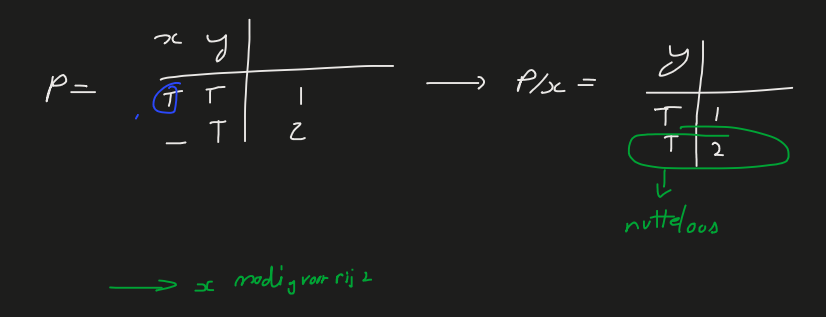
Nog een voorbeeldje:
> 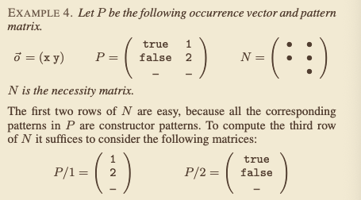

Bij P/2 zullen we nooit in de 3de rij geraken, bij P/1 wel (neem bvb 3)


### Heuristieken (Maranget 2008)

Een heuristiek kiest in stap 3 van ``\mathcal{CC}`` welke kolom ``i`` je eerst test.
Elke heuristiek geeft elke kolom een score; de kolommen met de beste score blijven over.
Heuristieken worden **gecombineerd** door ze na elkaar toe te passen op de overgebleven
kolommen (bv. ``pba`` = eerst ``p``, bij gelijkspel ``b``, dan ``a``).

#### Klassiek (uit eerder werk, o.a. Scott & Ramsey)

| Letter | Naam | Kies de kolom die… | Idee |
|---|---|---|---|
| ``f`` | first row | een constructor heeft in de **eerste rij** | eerste rij moet je toch testen (= nodig) |
| ``d`` | small defaults | de **minste wildcards** heeft | wildcards worden naar elke tak gekopieerd |
| ``b`` | small branching factor | de **minste takken** geeft (``\|\Sigma_i\|``, +1 als er een default nodig is) | smallere switch → kleinere boom |
| ``a`` | arity | de **kleinste totale ariteit** van zijn constructors heeft | minder nieuwe kolommen na specialisatie |

#### Nieuw in dit paper (gebaseerd op necessity)

| Letter | Naam | Score van kolom ``i`` | Idee |
|---|---|---|---|
| ``n`` | needed columns | aantal rijen ``j`` waarvoor ``i`` **nodig** is | test eerst wat het vaakst onvermijdelijk is |
| ``p`` | needed prefix | grootste ``j`` zodat ``i`` nodig is voor **alle** rijen ``1..j`` | bovenste rijen wegen het zwaarst (first-match) |
| ``q`` | constructor prefix | grootste ``j`` zodat ``p^{1..j}_i`` allemaal **constructors** zijn | goedkope benadering van ``p``: constructor ⇒ nodig, geen necessity-berekening |

#### Pseudo-heuristieken (tie-break / baseline)

- ``N``: kies de **meest linkse** kolom.
- ``R``: kies de **meest rechtse** kolom.

#### Kernideeën

- **Necessity:** kies je altijd een nodige kolom, dan zijn de paden optimaal kort.
- **Sterk nodig** (kolom met enkel constructors): dan blijft de boom klein, want er wordt niets gekopieerd.
- ``q`` vergt geen necessity-berekening, alleen het nagaan of er constructors staan, en is daardoor goedkoop.


# Plan van aanpak
Na het lezen van Maranget


## Appendix:


## random dingen en referenties


[sail-riscv]: https://github.com/riscv/sail-riscv/tree/master
[maranget]: https://www.cs.tufts.edu/~nr/cs257/archive/luc-maranget/good-trees08.pdf


**Shortcuts:**
cmd + shift + b -> quote
> This is a quote - Stan Kestens 

cmd + k -> will be some code snippet inline
`import python`
cmd + shift + k -> a code blok
```python
#this is a longer bit of code
for i in range(10):
    print(i)
```

cmd + ctrl + k -> latex

``x \in \mathbb{N}``

```math
formula : E = mc^2
```
